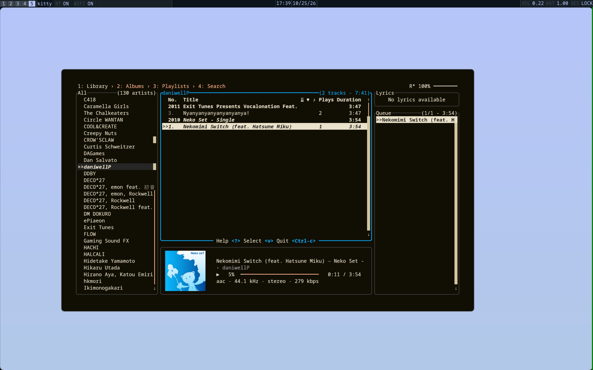

<h1 align=center>maurice</h1>
<h6 align=center>Continuation of previous ricing attempt.</h6>
<div align=center>


</div>

---

 <sub>The tool used in the screenshot is [`jellyfin-tui`](https://github.com/dhonus/jellyfin-tui)</sub>
## Installing
### Dependencies 
The code in this repo depends on packages/applications besides Quickshell.
  - `brightnessctl`, used for backlight display/manipulation (currently not working anyway lol)
  - [`hyprland`](https://hypr.land/), this is a Hyprland rice. Lua version preferable
  - `pipewire`, used for audio display/manipulation
  - `upower`, battery stuff
  - `cava`, visualizer stuff, disabled by default
  - `matugen`, creates colors for the shell
  - `curl`, for album art cache
  - `MapleMono-NF`, bundled in the repo, see [LICENSE](data/assets/fonts/MapleMono-NF/LICENSE.txt)
#### Arch
```
sudo pacman -S --needed hyprland brightnessctl upower cava pipewire quickshell curl matugen
```
### Guided
For a standard install, step-by-step
- **Ensure all dependencies are installed, packages for Arch Linux are listed above**
- Download the latest release from github
- Navigate to the `.zip` and extract (anywhere works, just be sure to extract)
- Run the `install.sh` script
> [!WARNING]
> The file must be executable in order to run. It should work already but if not, check permissions on the file.
> Please don't run random scripts! I know this one works but be careful!
- A backup of any existing Quickshell configs is created at `~/.config/quickshell.bak<timestamp>` before contents are copied over
- The script copies the contents of the extracted folder you downloaded, so you will need to get rid of that folder as you see fit
- This rice is built on Hyprland and does not currently set Hyprland up, please ensure you have Hyprland set up
- To run Quickshell, use the `qs` command in a terminal and add the `-d` flag if you don't want ugly logs and warnings (sorry..) showing up on terminal. If you want Quickshell to run on login, put this line somewhere in your Hyprland config (using Lua, not Hyprlang),
`hl.exec_cmd('qs')`
- For the Hyprlang version,
`exec-once = qs`
## MkDocs
MkDocs is used to display this repo's docs, simply install MkDocs and serve from this directory!
> [!NOTE]
> Alternatively, you can use the `site` directory, it should contain stuff to serve. From there you can serve the directory any way you want (as long as I remember to keep it up-to-date //v//).
## LLM Use
An LLM was used to generate some code in this repo. `/maurice/layers/bar/universal/Scramble.qml` was created by an LLM and modified by me, I did not make any of the logic.
The install script was also created by an LLM and modified by me. `art.sh`'s logic is also all by an LLM with modifications by me.
Some debugging was also done with an LLM, no agent touched my files though.
## Licensing
This repo is covered by an MIT license, see [license](./LICENSE). [`demo.mp4` ](./demo/demo.mp4) contains a track "Local Forecast" by Kevin MacLeod (incompetech.com) and is licensed under Creative Commons: By Attribution 4.0 License http://creativecommons.org/licenses/by/4.0/. The MIT does not cover this track and remains under its own terms.
### Fonts
Maple Mono NF, copyright 2022, The Maple Mono Project Authors. Licensed under SIL Open Font License, Version 1.1.
See [LICENSE](./maurice/data/assets/fonts/MapleMono-NF/LICENSE.txt).
## References
- RexCrazy804's Quickshell [`basic_bar` example](https://github.com/Rexcrazy804/quickshell-examples/)
- SelfMadeSystem's Quickshell [`shader_wallpaper` examaple](https://github.com/SelfMadeSystem/quickshell-examples/)
- [Quickshell docs](https://quickshell.org/docs/v0.3.0/types/)
- [QtQuick docs](https://doc.qt.io/qt-6/qtquick-index.html)
- [matugen-themes](https://github.com/InioX/matugen-themes/)
- [MapleMono NF](https://github.com/subframe7536/maple-font/releases)
